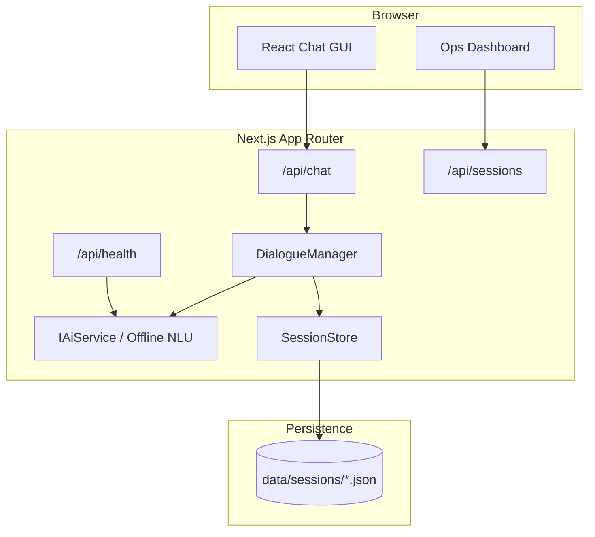

# System Architecture

## Layers

1. **Presentation** — branded React GUI (`ChatPanel`, ops table).  
2. **API / networking** — HTTP JSON route handlers.  
3. **Domain** — dialogue management, NLU, knowledge base.  
4. **Infrastructure** — JSON session store, logger, AI service interface.
